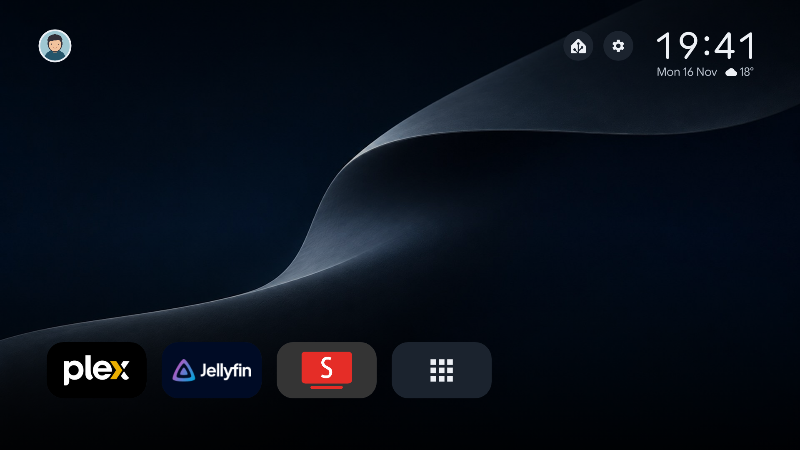
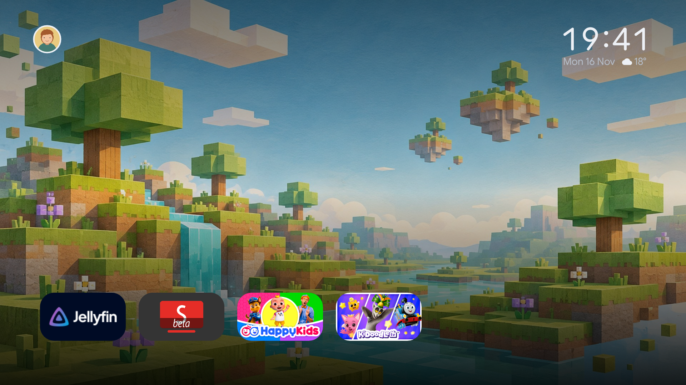
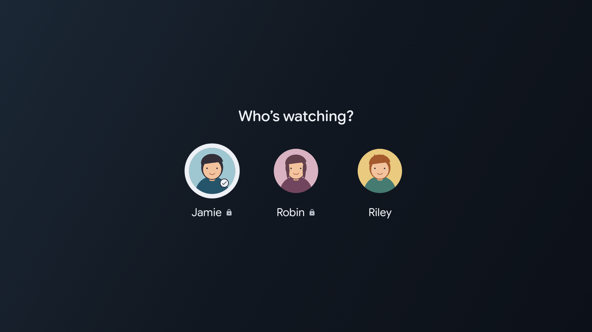
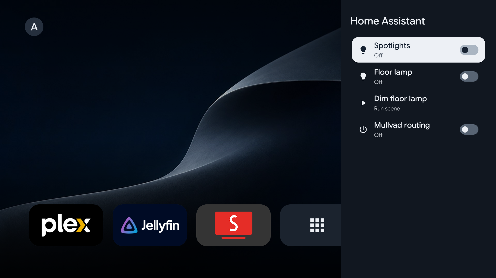

<p align="center">
  
</p>

<h1 align="center">Flick</h1>

<p align="center">An Android TV launcher with family profiles, photo wallpapers and Home Assistant controls.</p>

<p align="center">
  <a href="https://github.com/alphasixtyfive/flick/releases/latest"><strong>Download APK</strong></a>
  | <a href="SETUP.md">Setup guide</a>
  | <a href="docs/kids-profiles.md">Kids profiles</a>
  | <a href="docs/home-assistant-examples.md">Home Assistant examples</a>
  | <a href="https://github.com/alphasixtyfive/flick/issues">Report an issue</a>
</p>

Flick puts your favourite apps and photos on the TV's home screen. Each person can have
their own wallpaper and app order. Parents choose which apps appear for children and
protect adult profiles with a PIN. Use the remote to open apps, move tiles or turn down
the lights without opening a dashboard.

Built with Kotlin and Compose for TV. Supports Android TV and Google TV devices running
Android 8.0 or later.

- Favourite apps, All apps and Continue watching, with remote long-press menus.
- Adult and child profiles, parent PINs, profile photos and individual wallpapers.
- App ordering saved separately for each profile; parents control children's allowed apps.
- Photo slideshows from selected pictures, document folders or image URLs.
- Nine built-in wallpapers, with offline previews and a separate [4K download collection](wallpapers/).
- Clock, weather, navigation sounds and configurable home-screen controls.
- Three colour themes, with simple JSON import and export.
- Portable backups for profiles, preferences and local photos.
- Home Assistant lights, switches, scenes and device status.
- Optional TV pairing for notifications and remote profile, wallpaper and theme management.
- Check for GitHub updates in Settings, then confirm installation through Android.

See [themes](docs/themes.md) and [backup & restore](docs/backup.md) for details.

## Get started

1. Download the APK from the [latest release](https://github.com/alphasixtyfive/flick/releases/latest).
2. Install it on the TV, open Flick, then choose it in Android's Home/default-app settings.
3. Add your favourite apps and choose a wallpaper. Add family profiles when you're ready.

Keep the stock launcher installed so you can switch back through Android Settings.
Flick does not require root or an accessibility service. See the [setup guide](SETUP.md)
for installation, remote controls, photos and permissions.

## Screenshots

**A home for adults**

[](docs/screenshots/home.png)

**A smaller home for kids**

[](docs/screenshots/kids.png)

<table>
  <tr>
    <td><a href="docs/screenshots/profiles.png"></a></td>
    <td><a href="docs/screenshots/home-assistant.png"></a></td>
  </tr>
  <tr><td align="center"><strong>Who's watching?</strong></td><td align="center"><strong>Lights and scenes from the remote</strong></td></tr>
</table>

Screenshots render Flick's Compose screens with fictional profiles and sample data
in an isolated test environment.
Open an image to see it at full size. More: [wallpapers](docs/screenshots/wallpapers.png)
and [settings](docs/screenshots/settings.png).

## Kids profiles and streaming accounts

A child profile shows the apps a parent allows. Children can rearrange those apps;
changing access and opening adult settings require an adult profile.

Streaming apps keep their own sign-in. Switching Flick profiles does not automatically
switch the account inside Plex, Jellyfin or SmartTube. Where an app publishes two
editions with different Android package names, you can keep one for adults and set up
the other for a child. Our [kids profile guide](docs/kids-profiles.md) explains that
workaround, the SmartTube and Jellyfin examples, and the content controls still needed.

## Home Assistant

Choose the lights, switches, scenes and sensors you want on the TV. Ordinary controls
connect directly to Home Assistant using a dedicated non-admin account.

The optional [Flick TV integration](https://github.com/alphasixtyfive/flick-home-assistant)
adds TV notifications, profile management and wallpaper controls. Once paired, a simple
notification looks like this:

```yaml
action: notify.send_message
target:
  entity_id: notify.living_room_tv_notification
data:
  title: Laundry
  message: The washing is finished.
```

Replace the entity ID with the one on your paired TV's device page. See
[Home Assistant examples](docs/home-assistant-examples.md) for camera previews,
notification buttons, a dashboard card and wallpaper actions, or the
[connection protocol](docs/home-assistant-protocol.md) for development details.

For Windows PC sensors, notifications and controls, see [HASS Connect](https://github.com/alphasixtyfive/HASSConnect).

## Build

Use JDK 21 and Android SDK platform 35. Set `JAVA_HOME` and `ANDROID_HOME`, then run:

```powershell
./gradlew.bat assembleRelease
```

On macOS/Linux, use `sh ./gradlew assembleRelease`. The APK is written to
`app/build/outputs/apk/release/`. Release builds are unsigned unless private signing
settings are provided. CI artifacts are unsigned build outputs, not installable updates.

Use `assembleDebug` for an installable development build. A development build cannot
update an installation signed with another key. See [release signing](CONTRIBUTING.md#release-signing)
before building an update for an existing installation.

See [CONTRIBUTING.md](CONTRIBUTING.md) for checks and [ARCHITECTURE.md](ARCHITECTURE.md) for the code layout.

## Licence

Flick is [MIT licensed](LICENSE). Bundled Google Sans Flex TV is distributed under the
[SIL Open Font License](app/src/main/assets/licenses/google-sans-flex-ofl.txt).
See [third-party notices](THIRD_PARTY_NOTICES.md) for the font, Home Assistant artwork and dependencies.
