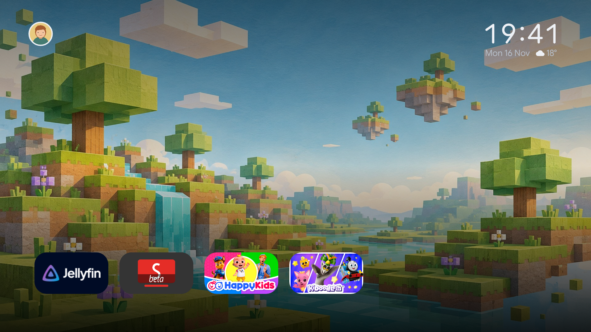

# Set up a TV home for kids

Flick can give a child a short list of apps and keep adult profiles behind a PIN.
It does not create a separate Android user or change the account inside a streaming app.
Set the content limits in each app as well as the app access in Flick.

## Start with the launcher

1. Open **Settings → Profiles** from an adult profile.
2. Set a parent PIN for every adult, then add a child profile.
3. Open the child's **Allowed apps** and enable only the apps you have prepared for them.
4. Choose an avatar and, if you like, a **Profile wallpaper**.
5. Under **On startup & wake**, choose **Ask who's watching**.

Children can hold OK on an allowed app and choose **Move** to change its position.
Their order is saved separately. They cannot add apps to their allowlist.

Returning from a streaming app keeps the current Flick session. Ask who's watching
resets on process startup or when Android reports the screen turning off. For a box
that stays awake when the television turns off, see [TV standby detection](../SETUP.md#profiles).

## Why an app can still open as the adult

Android normally gives an installed app one data area per Android user. A Flick profile
changes the launcher, while Plex, Jellyfin and SmartTube retain their own saved session.
Two shortcuts to the same installed app still open the same app data.

The straightforward option is the app's own profile chooser and parental controls.
For some apps, a second official edition is another option: different Android package
names let the two copies keep separate sign-ins on the same TV.

## Use a separate official edition

For example, the adult home can show SmartTube stable and ordinary Jellyfin, while the
child home shows SmartTube Beta and a separately packaged Jellyfin build. The child
copies are signed in only to the child's accounts.

| App | Adult copy | Separate child copy | Upkeep |
| --- | --- | --- | --- |
| SmartTube | Stable, `org.smarttube.stable` | Beta, `org.smarttube.beta` | Beta releases can have regressions. Keep its settings and account separate. Older stable installations may use a different package name. |
| Jellyfin for Android TV | `org.jellyfin.androidtv` | Official debug APK, `org.jellyfin.androidtv.debug` | A developer build with diagnostics, requiring deliberate manual updates. It is not a second stable release channel. |
| Plex for Android TV | `com.plexapp.android` | No separate current TV beta package established | Joining the beta updates the same app; it does not provide another sign-in. |

The SmartTube pair was checked with Beta 32.77; the Jellyfin pair with Android TV 0.19.10.
Use the projects' own [SmartTube releases](https://github.com/yuliskov/SmartTube/releases)
and [Jellyfin Android TV releases](https://github.com/jellyfin/jellyfin-androidtv/releases).
Check that the download has a different package name before relying on it as a second copy.
Updates must retain that edition's signing identity. A beta label alone does not mean
two copies can coexist.

1. Keep the existing adult app and its accounts.
2. Install the separate official edition, if the project publishes one for your device.
3. Sign in to the child copy using only the child's account. Configure its content limits.
4. In Flick, allow the child copy for the child and leave the adult copy off their allowlist.
5. Close and reopen the child app. Check its selected account, visible library and playback.
6. Switch back to an adult profile and check the original app still has its own account.

If a suitable separate edition is not available, use the app's supported profile controls
or another supported client. Repackaging an APK or copying login files adds maintenance
and security problems without creating reliable child content controls.

## SmartTube: configure the child copy carefully

SmartTube's **Child mode** is a settings and interface preset. It does not establish the
same age-filtered catalogue as YouTube Kids, even when the **Kids** section loads for a
supervised account. Do not treat successful Google sign-in as proof of equivalent supervision.

In the separate Beta copy:

- Keep only the child's saved Google account. Turn off account selection on startup.
- Under **General → Misc**, enable **Child mode** and choose a parent settings password.
- Under **Set-up sections**, leave **Kids** and remove other browsing sections. Choose
  **Kids** under **Boot to section**.
- Hide account switching, search, channel links and other browsing routes in the top
  buttons, context menu and player buttons. The Child mode preset does not remove all of these.
- Reopen the app and test with the physical remote, including long presses and voice/search keys.

Menu names can change between versions. Re-enabling Child mode reapplies its preset,
so make custom menu changes afterwards. Keep the settings password private.

These steps reduce the available routes through the interface. External search intents,
vendor remote buttons and app changes can expose other routes. If a guaranteed age setting
is required, use the service's officially supported child experience and its parental controls.
The [SmartTube implementation](https://github.com/yuliskov/SmartTube/blob/32.77/common/src/main/java/com/liskovsoft/smartyoutubetv2/common/app/presenters/settings/GeneralSettingsPresenter.java)
shows what its Child mode preset changes.

## Jellyfin: restrict the server account

Create a separate Jellyfin user for the child and configure that user's library access,
parental rating limit and treatment of unrated items on the server. Check the actual
titles visible to that user; a separate TV app does not filter an unrestricted library.
See Jellyfin's [user management documentation](https://jellyfin.org/docs/general/server/users/).

In the child TV copy, sign in only to that user. Select that user explicitly under
**Automatic sign in**, then restart the app and check it returns to the intended account.
Keep administrator and adult credentials out of this copy.

## Check the whole route

Before handing over the remote, check startup, wake, Home, Back, app return, account menus
and any dedicated remote buttons. Confirm adult profiles require their PIN and each child
app opens with the intended account and catalogue. Repeat those checks after app updates.

Flick's allowlist controls the apps available through Flick. Android Settings, another
launcher, external intents and system shortcuts remain part of the device's own security model.

[Back to Flick](../README.md) | [Full setup guide](../SETUP.md)
